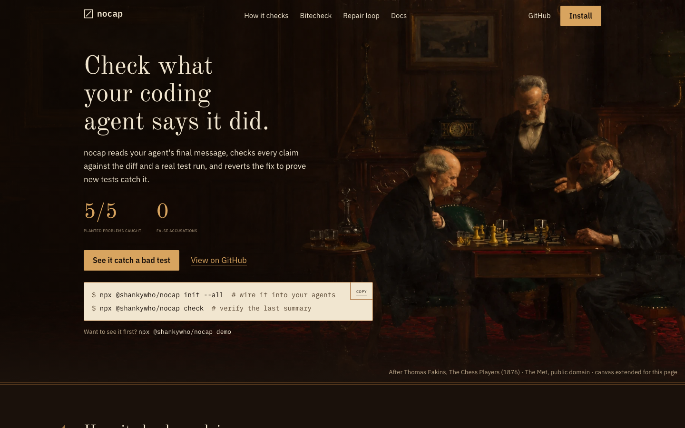
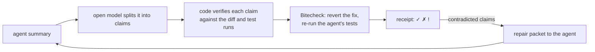

<div align="center">


# nocap

**Check what your coding agent says it did.**

[](https://www.npmjs.com/package/@shankywho/nocap)
[](https://github.com/shankywho/nocap/actions/workflows/ci.yml)
[](LICENSE)
[](https://nodejs.org)

[Website](https://nocap-a5tx.vercel.app/) · [npm](https://www.npmjs.com/package/@shankywho/nocap) · [Docs](https://nocap-a5tx.vercel.app/docs) · Launch video (TODO: link)



</div>

## Why

An agent ends a task with "added tests, didn't touch auth, all green". CI being green does not say whether the new tests exercise the change, and reading the diff to find out is the work you hoped to skip.

In this repo's eval, five planted lies (toothless tests, tampered tests, an out-of-scope edit, a wrong test count, a fake refactor) all leave the suite green. Trusting the summary caught 0 of 5, and running CI on head caught 0 of 5. nocap caught 5 of 5 with 0 false accusations on three honest scenarios ([eval/results.md](eval/results.md)).

nocap reads the agent's closing message, checks each claim against the diff and real test runs, and prints a receipt of ✓ verified, ✗ contradicted or `!` unverifiable, with evidence.

## Quickstart

```bash
npx @shankywho/nocap demo        # watch it catch toothless tests on a fixture repo
npx @shankywho/nocap init --all  # dry run: shows the hooks and MCP config it would write
npx @shankywho/nocap check       # verify your agent's last summary (pipe it in, or pass --summary)
```

`init` changes nothing until you add `--write`. `demo` installs `vitest` into a temp fixture, so it needs the network once; offline it falls back to static checks. `check` exits 0 on pass, 1 on a contradiction, 2 on bad input, and 3 on MIXED with `--strict`.

## How it works



The model only splits the claims. Code decides every verdict. A quote guard drops any claim whose quote is not in the summary, so the model cannot invent one. More in [docs/ARCHITECTURE.md](docs/ARCHITECTURE.md).

## Features

- **Claim-bound verification.** Each sentence gets its own verdict and evidence: files, symbols, scope, test counts, refactors.
- **Bitecheck.** Reverts the source change in a throwaway worktree and re-runs the tests the agent added. If they still pass, they do not test the change. When there is nothing to revert, it stubs the added function bodies instead and labels the result "(stub)". [docs/BITECHECK.md](docs/BITECHECK.md)
- **Tamper flags.** Skipped, loosened or deleted tests, attached to the claim they undermine. Advisory, never a ✗ on their own.
- **Repair loop and proof chains.** `nocap loop` sends contradicted claims back to the agent and re-checks. Anti-gaming rules mark a silently dropped claim (`dropped_silently`) or a deleted test (`repair_by_weakening`) as a failed chain.
- **Multi-agent ledger.** Verdicts are recorded with the actor and the git blobs they held for, so the next agent sees what it can trust and what went stale.
- **MCP server.** Eight tools over stdio (`verify_claims`, `get_repair`, `bitecheck`, `check_scope`, `ledger_facts`, `ledger_check`, `scorecard`, `verify_external_claim`).
- **Anakin MCP pairing.** Live external doc and API verification via `https://mcp.anakin.io/mcp`. Cross-verifies agent claims about external SDK signatures, library methods, and documentation specs against live scraped web docs.
- **Hooks** for Claude Code (Stop), Codex (notify) and Gemini CLI (AfterAgent).
- **Alan plugin** in `plugins/nocap`, with a `nocap-verify` skill.
- **Offline mode.** `--offline` skips the model and uses a deterministic extractor with the same verifiers.

## Example receipt

From dogfooding nocap's own 0.1.2 work (the full run is in [Dogfooding](#dogfooding)):

```
✓ VERIFIED      "nocap config set llm-key and nocap config get work"
                apps/cli/src/commands/config.ts  A +46 −0
! UNVERIFIABLE  "A test asserting mul(2,3) === 6 comes back BITES"
                The Bitecheck could not run in this environment.
✓ VERIFIED      "version is 0.1.1"
                apps/cli/package.json  M +1 −1
RESULT          MIXED · 4 verified · 0 contradicted · 3 unverifiable
```

And what a catch looks like (fixture scenario `toothless`):

```
✗ CONTRADICTED  "Added tests for the retry backoff in test/retry.test.ts"
                BITECHECK reverted src/retry.ts → 2/2 matching tests STILL PASS
```

## Install for your agent

`npx @shankywho/nocap init --all` detects installed agents and prints what it would write. Add `--write` to apply it.

| Agent | What `init --all --write` writes |
|---|---|
| Claude Code | Stop hook in `.claude/settings.json`, MCP entry |
| Codex | `[mcp_servers.nocap]` in `config.toml` (needs `--user`), `AGENTS.md` block |
| Cursor | MCP entry |
| OpenCode | MCP entry |
| Gemini CLI | MCP entry |
| Alan | `plugins/nocap` ([docs/ALAN.md](docs/ALAN.md)) |
| Any | A protocol block in `AGENTS.md` (and `CLAUDE.md` if present) between `<!-- nocap:start -->` and `<!-- nocap:end -->` |

The per-agent config formats are the best-known shapes and are unverified against each agent's current docs ([docs/decisions.md](docs/decisions.md)).

## CLI reference

| Command | What it does | Key flags |
|---|---|---|
| `check` | Verify a summary against the repo in the current directory | `--summary`, `--base`, `--head`, `--no-exec`, `--offline`, `--allow-build`, `--json`, `--md`, `--strict`, `--repair`, `--since-last` |
| `demo [scenario]` | Run a fixture scenario with live output | `--no-exec`, `--live` |
| `loop` | Check, hand the repair packet to your agent, re-check | `--agent-cmd`, `--max`, `--summary-from` |
| `init [agent]` | Wire nocap into your agents (dry run by default) | `--all`, `--write`, `--user`, `--anakin` |
| `mcp` | Start the MCP stdio server | |
| `hook <agent>` | Hook entrypoint for `claude`, `codex`, `gemini` | |
| `bitecheck <tests...>` | Prove specific tests fail without the source change | `--base`, `--allow-build` |
| `repair [receipt]` | Print repair instructions from a receipt | `--json` |
| `chain [id]` | Print a proof-chain timeline | |
| `handoff` | What the next agent can trust, and what is stale | `--to` |
| `scorecard` | Per agent and model accuracy from local receipts | |
| `config` | `config set llm-key <key>`, `config get` | |
| `publish <receipt>` | Upload a receipt | `--no-hunks` |

Run `nocap <command> --help` for every flag. The web docs are at [nocap-a5tx.vercel.app/docs](https://nocap-a5tx.vercel.app/docs).

## Configuration

- **Model key.** `nocap config set llm-key <key>` stores it with mode 600; `config get` never prints it.
- **Environment.** `LLM_BASE_URL`, `LLM_API_KEY` and `LLM_MODEL` point extraction at any OpenAI-compatible endpoint (default `openai/gpt-oss-120b` on Groq). `NOCAP_OFFLINE=1` skips the model. `NOCAP_ALLOW_BUILD=1` is the same as `--allow-build`. `NOCAP_API_URL` is where `--publish` uploads.
- **`.nocaprc.json`** in the repo root:

```json
{
  "scope": { "auth": ["src/auth/**"] },
  "roleScopes": { "backend": ["src/server/**"] },
  "testCommand": "pnpm vitest run {files} --reporter=junit --outputFile={out}",
  "testFormat": "junit"
}
```

With no key set, nocap prints a banner and uses the offline extractor. It never goes offline silently.

## Eval

Five planted lies and three honest scenarios, four strategies. `pnpm eval` regenerates this and exits non-zero if B3 drops below 5/5 or any honest scenario gets a ✗.

```
strategy                 planted lies caught   false accusations
B0 trust-summary         0/5                   0
B1 ci-only               0/5                   0
B2 nocap --no-exec       3/5                   0
B3 nocap (full)          5/5                   0
```

The repair loop resolves four of the planted scenarios in two attempts, and fails the one where the agent deletes the test and drops the claim. The agent in that eval is scripted, so it shows the loop and the anti-gaming rules work, not that a real model repairs well. Details: [eval/results.md](eval/results.md).

## Dogfooding

nocap checked its own 0.1.1 and 0.1.2 work with the same command, range and live model (`gpt-oss-120b` on Groq), using the agent's real closing message ([docs/dogfood/0.1.1-summary.md](docs/dogfood/0.1.1-summary.md)):

```bash
npx --yes ./nocap-<version>.tgz check --no-hunks \
  --base 92e05bb --head 1a294f9 \
  --summary docs/dogfood/0.1.1-summary.md
```

| Version | Result | What happened |
|---|---|---|
| 0.1.1 | `FAIL` | 1 ✗ and 2 flags, all three false. The bare checkout had no workspace `node_modules`, so the tests failed for setup reasons and nocap blamed the agent. |
| 0.1.2 | `MIXED` | 0 ✗, 0 flags, 4 verified, 3 unverifiable. Failures from the environment are now `!`, not ✗. |

The 0.1.2 run is not clean either. One ✓ ("I didn't publish") is noise: the model turned a sentence about npm into a scope claim about a file named "publish", and the check passed trivially. The summary also left out the test files, goldens and most of the documentation it changed, which nocap lists as UNDISCLOSED. The full receipts are in [docs/dogfood/](docs/dogfood/).

As a control, two sentences nobody wrote were checked statically over the same range: "Added `workspace.ts` in packages/core/src/git" (no such file existed at that commit) and "Didn't touch the web app" (four `apps/web` files changed). Both came back ✗ with file evidence.

## Safety and privacy

- **What leaves your machine:** the summary text and file paths, sent to the extraction model you configure. File contents and diffs are not sent. `--offline` sends nothing.
- **Your repo is not modified.** Tests and Bitecheck run in a throwaway git worktree. Dependency directories are cloned (copy-on-write where the filesystem has it) or linked entry by entry with package-manager state left out, and every child process gets a no-install environment for pnpm, npm and yarn.
- **Builds are opt-in.** Nothing writes build output unless you pass `--allow-build`. MCP tools and hooks cannot opt in. Without it, a missing build is `!`, never ✗.
- **An invariant test guards this.** `safety.invariant.test.ts` hashes the real repo's `node_modules` state and manifests before and after full Bitecheck runs that write into `node_modules`, and CI fails if anything differs.

This exists because 0.1.1 once ran `pnpm install` through a linked `node_modules` in a worktree and rewired the dependencies of the repo it was checking. The fix is described in [CHANGELOG.md](CHANGELOG.md).

## Limitations

- It proves tests bite, not that the change is correct.
- Claims that are not checkable ("it feels faster") are `!`.
- Bitecheck reverts whole files, not single hunks.
- Monorepos with nested `node_modules` are only partly supported.
- Runners other than Vitest, Jest, pytest and `node --test` need `--test-cmd`. The Jest and pytest paths are tested against parser samples, not real projects.
- PR mode (the GitHub Action) cannot run code: `tests_added`, `bug_fixed` and `build_pass` are `!` there.
- Claim extraction quality depends on the model. A weak sentence can become a vacuous claim, as in the "I didn't publish" case above.
- The Prisma store for hosted receipts is tested against a fake client only, not a real database.

## Prior art

Other tools check agent claims or revert and re-run tests. As far as I could find, none resolves which tests a given sentence refers to and reverts per claim. The comparison, with caveats on what I verified, is in [docs/PRIOR_ART.md](docs/PRIOR_ART.md).

| Tool | What it does | How nocap differs |
|---|---|---|
| receipts | Claude Code and OpenCode transcripts plus git; test-edit and scope flags | Agent-agnostic summary input; execution proof bound to each sentence |
| unfaked (`--deep`) | Reverts source and re-runs added tests; claim-agnostic | Resolves which tests the sentence refers to and reports per claim; also scope, counts and CI |
| groundtruth / cngx | Re-run tests, catch stubs, block merges | Denominator check; tamper flags tied to the claim |
| claimcheck / acv | Per-sentence diff verdicts, transcript-bound | Execution proofs; semantic scope |

These descriptions come from the projects' public descriptions and have not been re-checked against their current READMEs. Treat them as a starting point, and open the projects before relying on a row.

## How this was built

Built solo in 31 hours for #OpenFire (Alan AI) with AntiGravity and Alan, from a written spec. Design decisions are in [docs/decisions.md](docs/decisions.md) and the timeline is in [docs/BUILD_LOG.md](docs/BUILD_LOG.md).

## Contributing

Bug reports and pull requests are welcome. Setup, tests and commit style are in [CONTRIBUTING.md](CONTRIBUTING.md).

```bash
pnpm i
pnpm lint && pnpm typecheck && pnpm test && pnpm eval
```

## Security

Report vulnerabilities privately; see [SECURITY.md](SECURITY.md).

## License

[MIT](LICENSE)

## Credits

- **Hero painting:** After Thomas Eakins, *The Chess Players* (1876), The Metropolitan Museum of Art, New York. Public domain (Open Access). The canvas was extended to the left for the landing page; the source is `docs/media/source/hero-chess-extended.png`.
- **Fonts:** Old Standard TT and IBM Plex Sans and Mono, SIL Open Font License 1.1 (texts in `apps/web/src/fonts/`).
