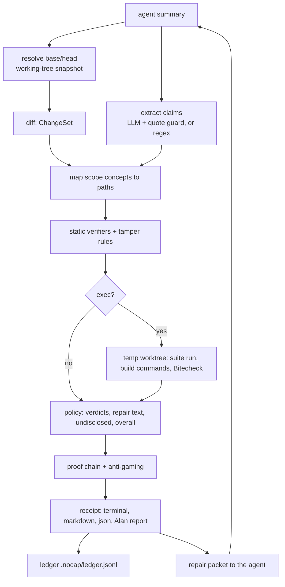

# Architecture

nocap is a pnpm monorepo. The engine in `packages/core` is pure: it never reads `process.env`, the filesystem, git or the network directly. Every dependency sits behind a port in `ports.ts`, and a shell (CLI, Stop hook, MCP server, web) supplies a real adapter or a deterministic mock.

The model only splits the summary into claims and maps concepts to paths. Code sets every verdict, and a ✗ needs hard evidence.

## Layout

| Path | Role |
|---|---|
| `packages/core/src` | engine: `extract/`, `verifiers/`, `tamper/`, `bitecheck/`, `exec/`, `policy/`, `loop/` (chains, anti-gaming, driver), `ledger/`, `scorecard/`, `static/prVerify.ts`, `render/` |
| `packages/core/src/adapters` | real and mock adapters; `local.ts` is the composition root for CLI, hook and MCP; `web.ts` is the network-only subset for the web app |
| `packages/mcp` | stdio MCP server, 7 tools |
| `apps/cli` | `nocap` commands, Stop hook, `init --all` |
| `apps/web` | Next.js: receipts, proof chains, scorecard, PR mode, demo SSE |
| `plugins/nocap` | Alan plugin and the `nocap-verify` skill |
| `fixtures/` | base project, 10 scenarios, curated PR (`fixtures/github`) |
| `scripts/` | `eval.ts`, `demo.ts`, `build-fixtures.ts`, `generate-examples.ts`, `mock-agent.ts` |

## Data

A receipt is immutable and carries its own `trace`, so the receipt is the run record. Receipts are validated with the zod `Receipt` schema; unknown fields are stripped on publish. Proof chains link receipts by `chainId` and `parentId`. The ledger is an append-only JSONL file with one line per claim verdict, and a fact is stale when its head is not an ancestor of HEAD or a recorded blob differs from the working tree.

## Web

`ReceiptStore` is the only storage interface. `MemoryStore` is seeded from `examples/*.json`; a Prisma store is not built (see DECISIONS.md). PR mode is a separate static pipeline (`prVerify`) over GitHub patches, with CI check runs standing in for the test run.
